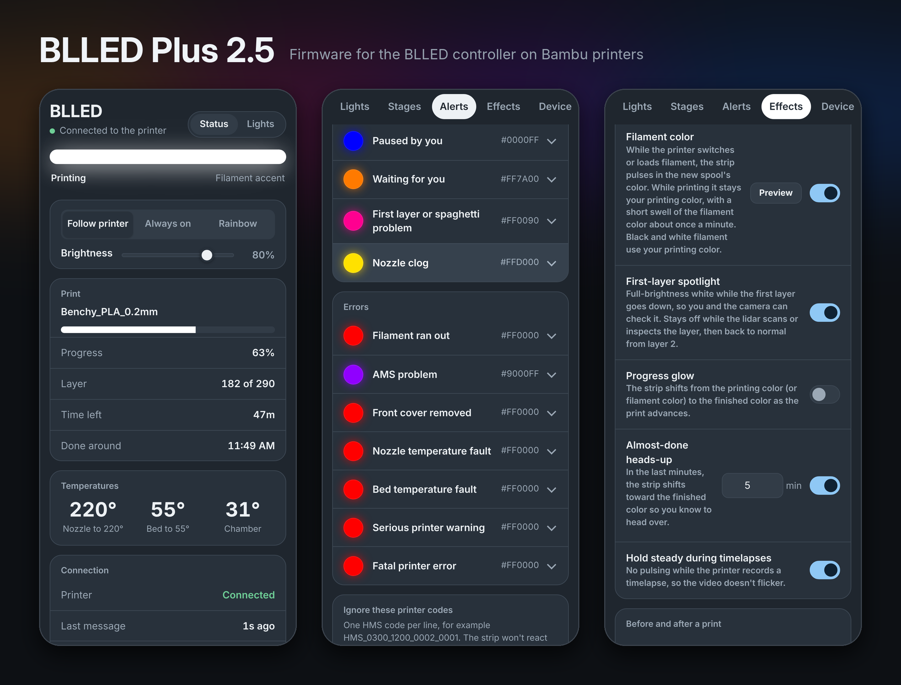
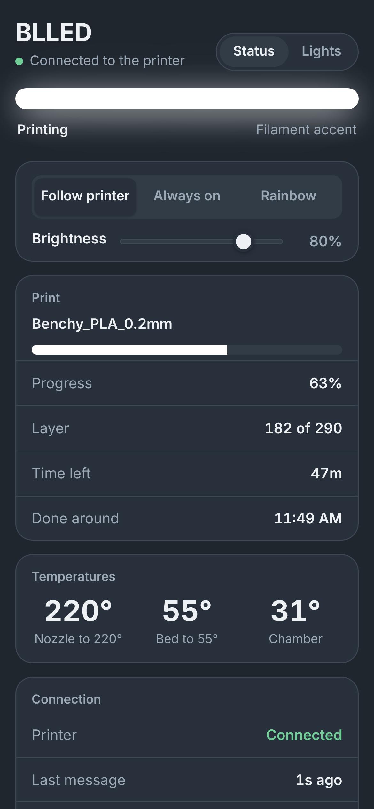
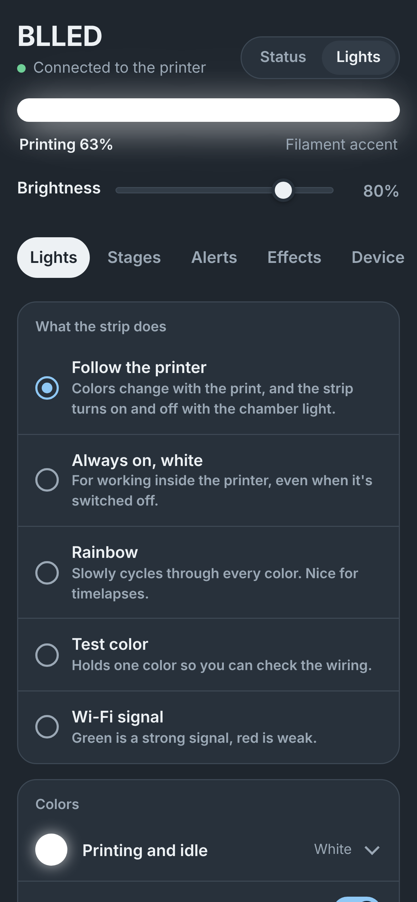
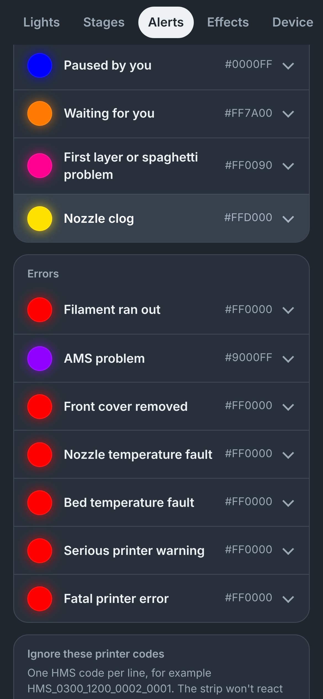
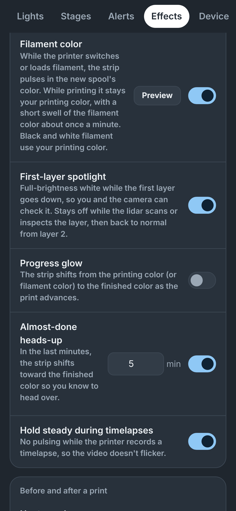

# BLLED Plus

Unofficial firmware for the **BLLED controller** on Bambu Lab printers. It started as a fork of [DutchDevelop's BLLEDController](https://github.com/DutchDevelop/BLLEDController) 2.3.0 and adds smarter lighting, a new web interface, updates straight from GitHub and a more stable connection. Tested on an X1C, with support for the H2 series (both nozzles, the external spools, and the H2C's Vortek hotend rack).

> Not made or endorsed by DutchDevelop or Bambu Lab. Same license as the original (CC BY-NC-SA 4.0): free for personal use, not for sale.

## Install

### Which file: full or lite

Each release has two files:

- **`BLLC_V<version>-lite.bin.ota`**: for controllers on the **original BLLED storage layout**. That's every controller bought from DutchDevelop or set up with the official web flasher. If you're not sure, use this one.
- **`BLLC_V<version>.bin.ota`** (full): for controllers moved to the **larger layout** (see below). It also has print notifications, the web log page and the Watch printer messages testing tool.

If you upload the full file to a controller on the original layout, the update page says there isn't enough space. Nothing breaks: just use the lite file. Once you're on BLLED Plus, you don't need to choose: **Update from GitHub** picks the right file for your controller. The status page shows "lite" after the firmware version if you're on lite.

### Update a controller that's already set up

Works from the official BLLED firmware or an older BLLED Plus. Your settings carry over.

1. Download the right `.bin.ota` from [Releases](../../releases) (see above). On a phone, save it to your Downloads.
2. On the same Wi-Fi as the controller, open **http://blled.local/fwupdate**, or open **http://blled.local** and tap **Update firmware** at the bottom of the settings page.
   If blled.local doesn't load, use the controller's number instead (for example `http://192.168.1.42/fwupdate`). Your router's app lists it under connected devices.
3. Choose the `.bin.ota` file and upload it. Don't unplug anything until it says it's done.
4. The page goes back to the home page once the controller is running the new version.

**Going back:** upload an official BLLED firmware file the same way.

### Updates from GitHub

Once you're on BLLED Plus, you don't need to download anything: open the update page and tap **Install** in the **Update from GitHub** card. The controller downloads the new release itself and checks its signature, so it only installs releases from this project. If it says it couldn't reach GitHub, tap **Check again**; the message says what went wrong.

To have it update by itself, turn on **Install new versions automatically** under **Updates** in the settings. It only installs while the printer isn't printing, and you can limit it to certain hours. If a new version doesn't start properly, the controller goes back to the version it had and won't try that release again on its own.

### Moving to the larger layout (optional)

Controllers on the original layout can switch to the larger layout over Wi-Fi with **Move to the larger layout** on the update page, and then get the full edition. It takes about 2 minutes and keeps your settings. Keep it plugged in until it's done: for a fraction of a second it rewrites the table that divides up the chip's storage, and losing power at exactly that moment means re-flashing over USB. Losing power at any other point is fine. Lite gets every lighting feature, so the move is only worth it if you want print notifications, the web log page or the testing tool.

Over USB, `migrate-layout.bat` does the same without that risk (it backs up the settings first).

### Set up a brand-new controller

1. Flash the official firmware with the [BLLED web flasher](https://dutchdevelop.github.io/blledsetup/) (Chrome or Edge on a computer, controller plugged in over USB).
2. On your phone, join the Wi-Fi hotspot **BLLED_AP**. The setup page should open by itself. If it doesn't, go to **http://192.168.4.1**.
3. Choose your home Wi-Fi and enter its password.
4. Enter your printer's details, all found on the printer's screen:
   - **IP address** and **access code**: Settings, then WLAN / Network
   - **Serial number**: Settings, then Device
5. Save. The controller restarts and joins your Wi-Fi.
6. Install BLLED Plus with the update steps above.

### Settings

- **http://blled.local/** - lights, colors, effects and everything else
- **http://blled.local/status** - what the strip is doing, print progress, temperatures, connection health, the **Activity log**, and **Restart controller** / **Reconnect to printer** buttons
- **http://blled.local/backuprestore** - save your settings to a file and restore them

Each setting has a **Preview** button that shows it on the real strip without saving.

### Phones

- If the page won't open in Chrome on Android, try Samsung Internet or Firefox. Some browsers force `https://`, and the controller only speaks `http://`.
- Give the controller a fixed address in your router (often called *address reservation* or *DHCP reservation*), so a router restart never moves it.

### Home Assistant

**[BLLED Plus for Home Assistant](https://github.com/SCHSwork/ha-blled-plus)** adds the controller to Home Assistant: the strip as a light (with the modes as effects), a **Dismiss error** button, sensors, and firmware updates in Home Assistant's Updates list. Install it through HACS as a custom repository. It needs BLLED Plus 2.8.50 or newer. Full-edition controllers are found automatically; for lite, enter the controller's address.

### Phone app (Android)

The BLLED Plus app opens your controller's pages without typing an address, and file uploads (firmware and settings backups) work in it. Download `BLLED-Plus-app-<version>.apk` from the newest **app-v** release on the [Releases](../../releases) page and install it (allow installing from your browser when Android asks). The app checks for its own updates.

### Troubleshooting

| What you see | What to do |
|---|---|
| Strip blinks dim red | The printer refused the access code. Check it on the printer screen (it changes if LAN settings change) and update it under Wi-Fi and printer connection. |
| Status page says the serial belongs to a different printer | Tap the button on the status page to use the printer that's actually at that address. |
| "Connected, but the printer isn't sending anything" | The serial number is for a different printer. Re-enter it. |
| Can't reach the controller | Try `http://blled.local`. Check that your phone is on the same Wi-Fi, not a guest network. Unplugging the controller for 10 seconds restarts it. |
| "Not enough space" when uploading | Your controller is on the original layout. Upload the `-lite` file instead. |
| "Couldn't reach GitHub" | Tap **Check again**. The message says whether it was the internet, memory or GitHub itself. |
| Not connecting to the printer after a restart | Give it a minute, it keeps retrying. If it doesn't come back, tap **Reconnect to printer** on the status page. |
| High-pitched whine from the controller | Turn on **Silent mode** in the settings. |

The **Activity log** on the status page shows what the controller has been doing, including why it last restarted. If it ever crashes or freezes, the next start adds a **[Crash]** entry. Please include those lines when you report a problem. On the full edition, the live log is also at **http://blled.local/webserial**.

## What it does

**While printing**
- **Filament color**: pulses in the incoming spool's color during AMS swaps and loading; while printing it stays your normal color with a short filament-color swell about once a minute.
- **First-layer spotlight**: full-brightness white for layer 1. Every lidar step (bed scan, extrusion calibration, first-layer inspection) keeps its own dark setting.
- **Almost-done heads-up**: shifts toward the finished color in the last minutes.
- **Progress glow** (optional) and **hold steady during timelapses**.

**Before and after**
- **Heat-up glow**: blue, purple, red, orange as the bed or nozzle heats, at print start or from the printer screen.
- **Safe to remove**: holds the finished color until the bed has cooled.
- **Finish celebration**: a short rainbow when a print ends.

**Problems, each with its own color**
- Waiting for you (amber, breathing): the print paused on its own. Pauses you make keep the pause color.
- First layer or spaghetti (pink), nozzle clog (yellow), AMS problem (purple), filament runout and faults (red).

**Around the house**
- **Door work light**, and lights the door turned on go back off when it closes.
- **Lights on for the camera**: opening the printer's camera in Bambu Handy turns the printer's light (and the strip) on, then back off after a time you choose. The printer doesn't say when the camera closes, so it's a timer.
- **Dims when idle** before turning off, and **quiet hours** at night.
- **Printer light sync**: the chamber light follows the strip outside prints.
- **Preview** any color or effect on the real strip before saving.

**Print notifications** (full edition)
- Sends to a **Discord** channel (webhook), the **ntfy** phone app (ntfy.sh or your own server), and/or any **webhook** as JSON (Home Assistant, Node-RED). Set them up on the **Notify** tab and use the **Try it** buttons to send a made-up example of each kind (to all services or just one).
- You pick what's worth a ping: print finished (with how long it took), failed or cancelled, the printer needs you (runout, clog, first-layer or spaghetti problem, AMS problem, a pause in the file, serious errors; not pauses you make), print started, first layer done, and progress every 10 / 20 / 25 / 50 %.
- Each notification links to the controller's status page at blled.local (or whatever you named the controller). If there isn't enough memory for the printer connection and a secure web connection at the same time, the printer connection is held for the few seconds the send takes.
- **Where each one goes**: a grid on the Notify tab picks which services get each kind, e.g. everything to ntfy but problems to Discord only. The progress bar can be turned off.
- **Your own wording**: every kind of notification has a title and message you can rewrite, with fill-ins like `{job}`, `{bar}` (a progress bar), `{percent}`, `{remaining}`, `{duration}`, `{reason}`, `{hms}` and `{printer}`. Text in `[ ]` is left out when a fill-in inside it isn't known.
- **Alerts for printer codes**: lines like `HMS_0700_* = AMS needs a look ({hms})` or `0300_8003 = Spaghetti on {job}` send your own message when that HMS code or print error shows up, even codes that don't pause the print. `off` silences a code (including its "needs you" message).
- The webhook gets `event` (`finished`, `failed`, `needs_you`, `started`, `first_layer`, `progress`, `alert`, `test`), `title`, `message`, `job`, `percent`, `layer`, `totalLayers`, `remainingMins`, `printError`, `hms` and `url`.

**H2 series**
- Follows the active nozzle and the spool feeding it, including the external spools.
- H2C: its own color while the Vortek rack is picking, placing or swapping a hotend.

**Web interface and connection**
- New settings and status pages: print progress, time left, "done around", temperatures, connection health and the controller's address.
- **Printer errors in plain English**: the status page and Activity log show what an error code means (Bambu's own description, with the H2 wording on H2 printers) and link to the Bambu wiki.
- Non-blocking LEDs, MQTT back-off and watchdog, Wi-Fi recovery, and a settings-page self-check that restarts a frozen web server (never mid-print).
- **Settings that survive power cuts**: saved so a cut mid-save can't damage them, never wiped when they can't be read right after power comes back, and kept in a second copy in case the storage is ever reformatted.
- **Signed updates from GitHub**, optional automatic updates, and going back to the previous version if a new one doesn't start.
- **Silent mode** for controllers that whine while the strip is dimmed.
- The controller shows up as "BLLED" in your router and at `blled.local`.

## Screenshots

| Status | Lights | Alerts | Effects |
|---|---|---|---|
|  |  |  |  |

## Building from source

- **Windows:** install PlatformIO, then run `build-firmware.bat`. `flash-firmware.bat` flashes over USB.
- **Linux:** `tools/build-ota-linux.sh <toolchain-dir>` builds the `.bin.ota` with arduino-cli, plus the `.elf` for decoding crash reports. `EDITION=lite` builds the lite edition. `tools/decode-crash.sh <elf> <addresses>` turns a `[Crash]` entry into code lines (the `.elf` must come from the exact version that crashed).
- The web pages in `src/www` are compressed into `.h` files by `pre_build.py` before every build. Those generated files aren't checked in. Lines between a comment containing `@full-only` and one containing `@end-full-only` are left out of the lite edition's copy of the page.
- **Releases:** putting `releases/BLLC_V<version>.bin.ota`, `releases/BLLC_V<version>-lite.bin.ota` and optionally `releases/notes-v<version>.md` on `main` makes the Release workflow publish them, signed with the `BLLED_SIGNING_KEY` repository secret. Controllers only install GitHub updates whose signature matches the public key in `src/blled/signing_key.h`, so a fork needs its own key pair there and in its secrets.
- **Size limits:** the lite edition must fit the original layout's 1,310,720-byte slots, the full edition the larger layout's 1,966,080 (`min_spiffs.csv`). The Release workflow refuses anything bigger.
- **Phone app:** changes under `android/` on `main` make the Android app workflow build and sign the APK and publish it as an `app-v<version>` pre-release.

---

## License and credits

### License

BLLED Plus, like the original BL Led Controller, is released under Creative Commons Attribution-NonCommercial-ShareAlike 4.0 International (CC BY-NC-SA 4.0) license. See [LICENSE](LICENSE). Free to share and change for non-commercial use, with credit, under the same license.

### Credits

**BLLED Plus**
- **[Lincoln (SCHSwork)](https://github.com/SCHSwork)**: creator of BLLED Plus. New lighting features, web interface, phone app, connection fixes and testing on the X1C.
- **Community testers on Discord**, including 4x4ffsa (first move to the larger layout over Wi-Fi), nspike05 and Code_No_One, for bug reports and testing.

**Printer error descriptions** are Bambu Lab's, collected by [ha-bambulab](https://github.com/greghesp/ha-bambulab) (MIT license, see `tools/hms/LICENSE-ha-bambulab`).

**Original BLLEDController**, which BLLED Plus is built on
- **[DutchDeveloper](https://dutchdevelop.com/)**: creator and lead programmer
- **[Modbot](https://github.com/Modbot)**: tester for X1C, P1P & P1S
- **[xps3riments](https://github.com/xps3riments)**: inspiration for the foundation of the code
- **[longrackslabs](https://github.com/longrackslabs)**: build process, documentation, developer & community support
- **[SoftWareCrash](https://github.com/softwarecrash)**: smaller changes
